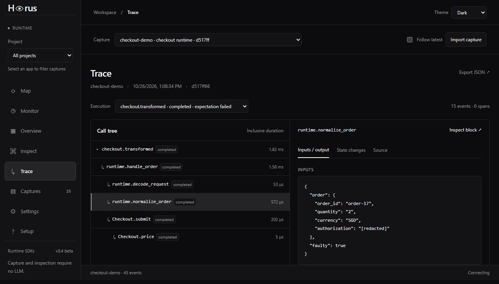

# Horus

Horus records selected function calls, values, checkpoints, and failures. Follow requests, compare executions, and explore observed call relationships in a local workspace. Coding agents can read the same evidence through MCP. No LLM is required.

**Beta 0.4.0 · GPL-3.0-only · Maintained by [bugdeployer](https://github.com/bugdeployer)**



Sample capture from the test fixtures; no production data.

## Install

Beta packages are being prepared. Registry links will be added after publication.

| Distribution | Link |
| --- | --- |
| Workspace CLI · npm | |
| JavaScript / TypeScript SDK · npm | |
| Python SDK · PyPI | |
| PHP SDK · Packagist | |

After [development setup](CONTRIBUTING.md), build the artifacts and install the CLI tarball:

```sh
python scripts/build_release.py
npm install -g ./dist/bug_deployer-horus-0.4.0-beta.1.tgz
horus setup
horus start
```

Open **http://127.0.0.1:3100**. Setup requires Node.js 22+ and Python 3.11+ with venv support. It creates an isolated Python environment and downloads dependencies. No Docker or frontend build is needed after installing the CLI package.

Use `horus doctor`, `horus status`, and `horus stop` to manage the workspace. See [setup](docs/setup.md) for development, Docker, SDKs, and storage.

## Connect an application

Install the SDK for your runtime and instrument the code you want to inspect. The Setup page includes Python, Node JS/TS, browser, and PHP examples.

```python
from horus_sdk import Recorder, observe, checkpoint

@observe
def process(order):
    checkpoint("order", order)
    return {**order, "processed": True}

recorder = Recorder("my-app", endpoint="http://127.0.0.1:3100")
with recorder.trace("request"):
    process({"id": 17})
```

Completed instrumented traces are delivered automatically. Use one recorder per request. PHP requires its spool worker; browser delivery requires a same-origin proxy. Redaction defaults to enabled and can be disabled in integration code. [Delivery and limits](docs/automatic-capture.md)

## Workspace

- **Overview:** execution summaries, errors, and failed expectations.
- **Inspect:** function and class activity, captured state, and execution comparisons.
- **Trace:** nested calls, values, checkpoints, expectations, and saved source excerpts.
- **Monitor:** observed activity, median/p95 duration, and slow blocks, refreshed every two seconds.
- **Map:** captured structure, observed calls, and usage heatmaps linked to execution evidence.
- **MCP:** read-only tools for agents to inspect captures, sources, comparisons, and topology.

Captures are stored in SQLite and can be imported or exported as JSON. Project selection filters evidence by application. Dark and light themes are available.

## Scope and limits

Horus observes explicitly instrumented code. It does not automatically attach to applications, scan entire repositories, infer data lineage, or correlate distributed services. Empty time intervals do not establish that an application was idle or offline.

Buffers, values, and delivery queues are bounded. Evidence can be dropped or truncated. Python/JS delivery is best effort; PHP retains failed spool uploads. The workspace reports the limits it can observe.

This local beta has no authentication. Keep it on loopback. Captures may contain application data; inspect them before sharing. External integration coverage currently includes one Python application, with focused SDK tests for other runtimes. [Verification](docs/verification.md)

## Development

```sh
python -m pip install -r requirements-dev.txt
python -m pip install -e packages/sdk-python -e apps/collector
npm ci
npm --prefix apps/console ci
python -m pytest -q
node --test packages/sdk-javascript/tests/*.test.js
```

Source: `apps/console`, `apps/collector`, and `packages`. See [contributing](CONTRIBUTING.md), [API](docs/api.md), [MCP](docs/mcp.md), and [releasing](docs/releasing.md).

## Maintainer

bugdeployer leads engineering, sets the architecture and runtime model, and makes final implementation decisions. The project uses [AI-assisted programming](AI_ASSISTANCE.md).

## License

[GNU GPL version 3 only](LICENSE). Package metadata uses `GPL-3.0-only`. Dependencies retain their own licenses.
